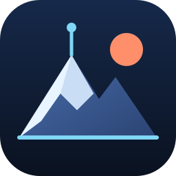
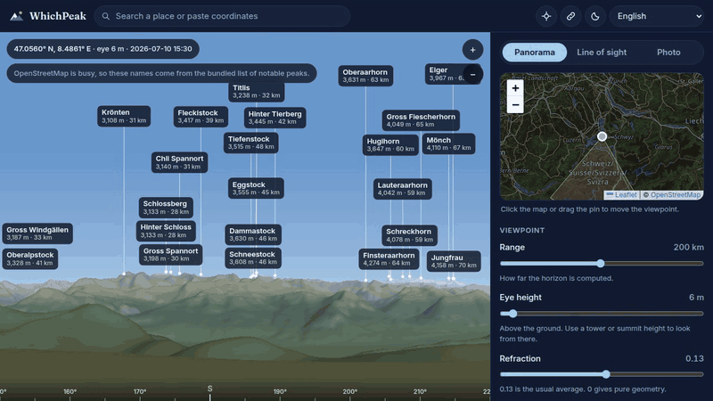

<div align="center">

[English](README.md) | [繁體中文](README.zh-TW.md) | [简体中文](README.zh-CN.md) | [日本語](README.ja.md) | [한국어](README.ko.md) | [Español](README.es.md) | [Français](README.fr.md) | [Deutsch](README.de.md) | [Português (Brasil)](README.pt-BR.md)



# WhichPeak

_那座山叫什麼名字？站在任何地方，都能得到標好名稱的 360 度全景。_

**150 公里全景的地形在 4.6 秒內繪製完成。** 數字取自格爾內格拉特（Gornergrat）冷快取下在無頭 Chrome 以真實網路連續六次、到地形繪製完成的中位數。山峰名稱另外載入。方法見 [docs/benchmarks.md](docs/benchmarks.md)。



[](https://github.com/Arthur031221/WhichPeak/actions/workflows/ci.yml)
[](LICENSE)
[](https://arthur031221.github.io/WhichPeak/)

</div>

WhichPeak 會畫出你站在地球上某一點所能看到的景象，並替山峰標上名字。它讀取開放的高程圖磚，加入地球曲率與大氣折射，依你選的時刻用真實的太陽為地形上色，並只為真正看得到的山頂加上標籤。整個程式在瀏覽器內執行，沒有伺服器、不需要帳號，照片也不會離開你的裝置。

我不想給出一個很有把握卻是錯的答案，所以工具不確定時會直接說出來。照片比對不準，就會標示為比對不佳。

## 為什麼做這個

> 我想要一個方法可以讀懂、可以修改、也能自己架設的全景工具。核心是不用框架的純 TypeScript，畫面上的每個數字都能追溯到一塊高程圖磚。

## 它能做什麼

| 你做這件事         | WhichPeak 給你                                                 |
| ------------------ | -------------------------------------------------------------- |
| 打開連結或放下圖釘 | 最遠 400 公里的 360 度全景，由六個細節層級的圖磚組成           |
| 調高視點高度       | 從高塔或山頂望出去的景色，地平線會像真實情況一樣下沉           |
| 拖動時間滑桿       | 太陽、霧氣與雪線會隨日期與緯度變化                             |
| 點選標籤           | 海拔、距離、方位角、地平線以上的仰角，以及山峰高出遮擋地形多少 |
| 切換到視線模式     | 兩點之間的剖面圖，並標出擋住視線的山脊                         |
| 分享頁面           | 一個記錄地點、視角、範圍與時刻的連結                           |

山峰資料來自 OpenStreetMap，透過四個 Overpass 鏡像取得。若全部沒有回應，會改用內建的 35,621 座海拔 1800 公尺以上山頂清單，因此標籤仍然會出現。

## 試試看

```sh
git clone https://github.com/Arthur031221/WhichPeak.git
cd WhichPeak
npm install
npm run dev
# 開啟 http://localhost:5173/#lat=47.056&lon=8.48609&az=210&eye=6&fov=70&r=200
```

這個連結是從瑞士的 Rigi Kulm 望向約 70 公里外的少女峰與艾格峰。同樣的畫面也在[線上展示](https://arthur031221.github.io/WhichPeak/#lat=47.056&lon=8.48609&az=210&eye=6&fov=70&r=200&t=2026-07-10T14:30Z)。

<details>
<summary>各種環境的安裝方式</summary>

**線上頁面。** 開啟線上展示即可，不需要安裝任何東西。

**從原始碼執行。** 需要 Node.js 20.19 以上。執行上面的五行指令。

**自己的靜態主機。** 執行 `npm run build`，把 `dist/` 複製到任何網頁伺服器。若放在子路徑，請用 `GITHUB_PAGES=1` 建置以取得 `/WhichPeak/` 基底路徑，或修改 `vite.config.ts` 的 `base`。

**GitHub Pages 上的分支。** 啟用 Pages 並選擇 GitHub Actions 作為來源。`.github/workflows/pages.yml` 會在 `main` 的 CI 通過後建置並部署。

更多說明見 [docs/install.md](docs/install.md)。

</details>

## 能信任到什麼程度

曲率與折射是我檢查得最嚴格的部分。視線工具只要差幾公尺，就會誤判山峰是否可見，所以我用兩條有人記錄過的視線來測試。

| 視線                               | 距離     | 平均折射（k = 0.13）下的結果      |
| ---------------------------------- | -------- | --------------------------------- |
| Pic de Finestrelles 到 Pic Gaspard | 443 km   | 被擋住 48 公尺。k 達 0.145 時可見 |
| Marys Peak 到 Mount Rainier        | 295.8 km | 可見，餘裕 78 公尺                |

第一條視線是 2016 年在強折射下拍到的，所以在平均設定下被擋住、在 0.145 時打開，正是我預期的答案。求解器寧可把山峰判為看不到，因為一個高程格大約有 76 公尺寬。

**照片模式仍是實驗性質。** 我用八張在格爾內格拉特拍的一般照片測試，設好地點但不給方位，結果只有一張比對成功。其餘七張被標為比對不佳，我用肉眼檢查過的那幾張確實是錯的。沒有任何一張在錯誤時被回報為成功。請用在天際線乾淨且知道拍攝地點的照片，沒對上時可以手動微調滑桿。八張的完整結果在 [docs/benchmarks.md](docs/benchmarks.md)。

在非常陡的地面上，前景可能出現拖影，因為每一欄像素只保留看過的最大坡度。這是已知的外觀瑕疵，不影響標籤。

## 語言

介面提供英文、繁體中文、簡體中文、日文、韓文、西班牙文、法文、德文與巴西葡萄牙文，可從標題列的切換器選擇。單位可在公制與英制之間切換，也有深色與淺色主題。

## 文件

- [安裝](docs/install.md)
- [使用方式](docs/usage.md)
- [設定與網址參數](docs/config.md)
- [架構](docs/architecture.md)
- [基準測試](docs/benchmarks.md)

## 參與貢獻

歡迎回報問題與提交 pull request。[CONTRIBUTING.md](CONTRIBUTING.md) 列出要先執行的檢查：97 個單元測試、10 個瀏覽器測試、型別檢查與格式檢查。

## 資料來源

高程：AWS Terrain Tiles。山峰與底圖：OpenStreetMap 貢獻者。地點搜尋：Nominatim。山峰備援資料：Wikidata。內建資料的授權見 [THIRD_PARTY_NOTICES.md](THIRD_PARTY_NOTICES.md)。

以 MIT 授權釋出，見 [LICENSE](LICENSE)。

Assisted by Claude/Codex.
